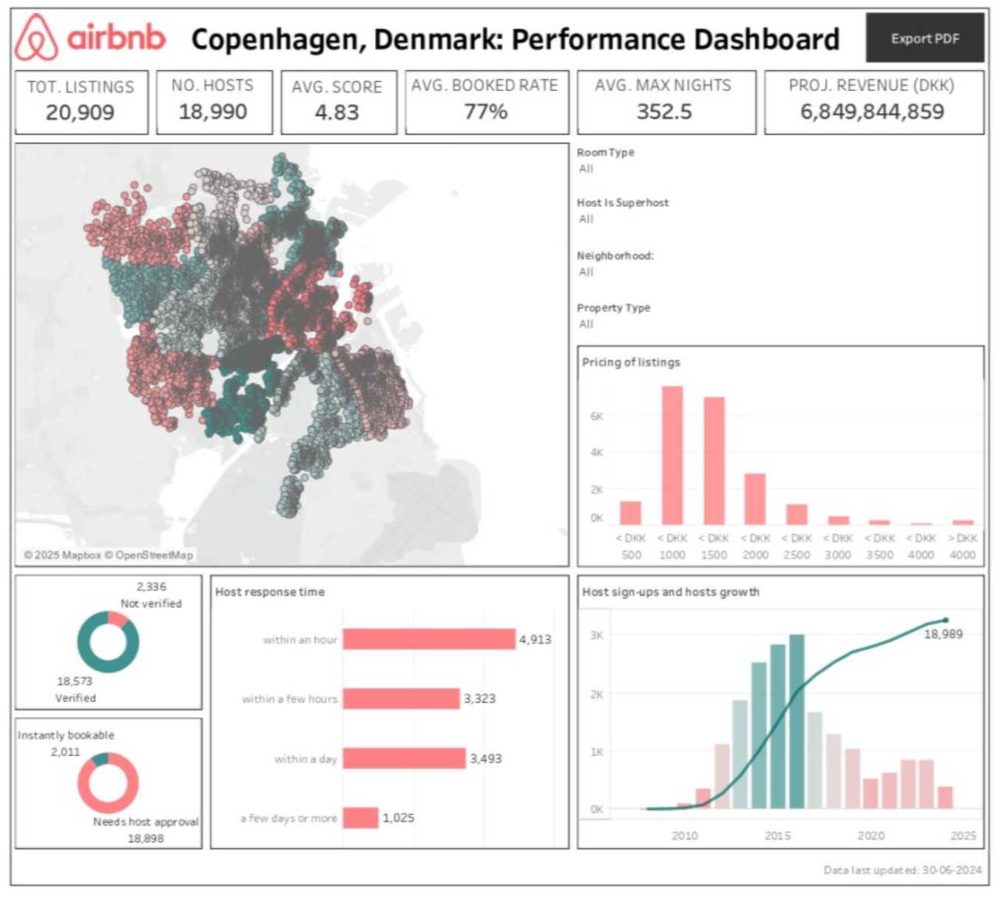
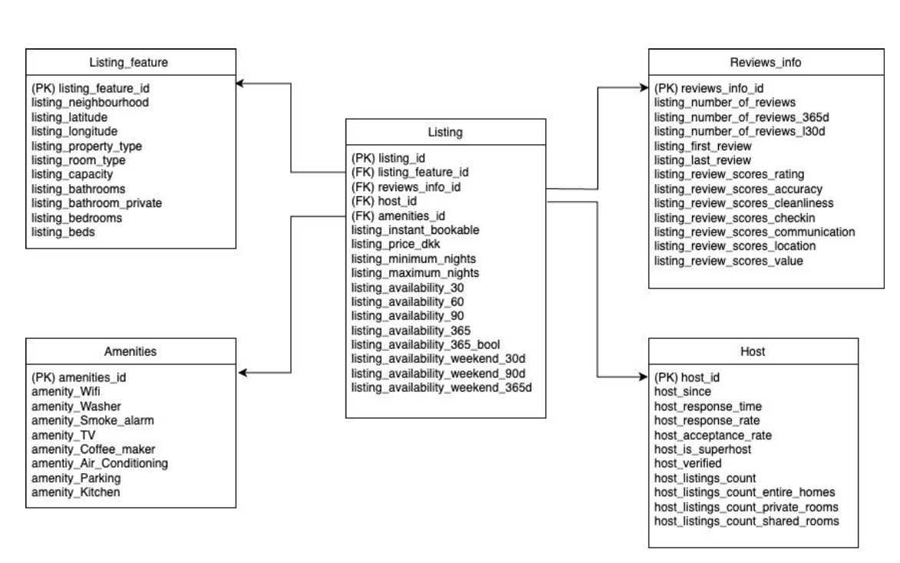

# Airbnb Copenhagen Market Analysis

## Project Overview
This data analysis project translates raw data into actionable business strategies to support Airbnb's strategic goals, focusing on market growth, host engagement, and regulatory compliance.

## Dashboard Preview
   

## Key Findings
* **Pricing & Demand:** Listings priced between DKK 1,000 - 1,500 per night are the most in demand. Additionally, properties offering Instant Booking correlate with higher pricing power.
* **Host Dynamics:** Host signups have declined sharply since 2015. Most hosts manage only 1 listing, and Superhosts account for merely 10% of the market, hindered by strict platform criteria.
* **Market Gaps & Compliance:** There is significant untapped growth potential in the luxury listings segment. Furthermore, the average maximum stay limit set by hosts (352.5 nights) significantly exceeds Denmark’s legal regulations (70-100 nights).

## Business Recommendations
Based on the data, we recommend the following strategic actions for the Copenhagen market:
* **Optimize Market Segments:** Expand the luxury listing segment with clear labeling, and deploy targeted marketing in top neighborhoods (Nørrebro, Indre By, etc.) while developing selling points for less popular areas.
* **Revamp Host Engagement:** Incentivize co-host participation to boost supply, provide automated tools to improve host response rates, and lower barriers (or provide education) to increase the Superhost population.
* **Regulatory Compliance:** Proactively educate hosts and implement system restrictions to ensure maximum stay limits comply with the 70-100 nights regulation.
* **Pricing Strategy:** Guide standard listings toward the DKK 1,000 - 1,500 sweet spot and actively encourage hosts to enable Instant Booking to maximize revenue.

## Data Pipeline
* **Data Cleaning (Python):** Handled inconsistencies, removed redundant columns, and standardized variables across raw datasets (listings, calendar, reviews).
* **Data Storage (SQL):** Designed and transformed the cleaned dataset into a Star Schema to enable efficient analytical querying.

     

* **Data Visualization (Power BI / Tableau):** Developed a comprehensive dashboard containing 6 core visualizations for executive reporting.

## How to View This Project
To interact with the data model, cross-filter charts, and explore the visualizations locally:

1. Download the source file: **[Copenhagen_Airbnb_Dashboard.pbix](https://github.com/Levennnnn/Airbnb-Copenhagen-Dashboard/raw/main/Power%20BI%20-%20Airbnb%20Copenhagen%20Dashboard.pbix)** or **[Copenhagen_Airbnb_Dashboard.twbx](https://github.com/Levennnnn/Airbnb-Copenhagen-Dashboard/raw/main/Tableau%20-%20Airbnb%20Copenhagen%20Dashboard.twbx)**.
2. Ensure you have Power BI Desktop or Tableau Desktop installed on your machine.
3. Open the downloaded file to view the full functionality.
